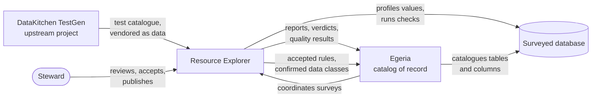
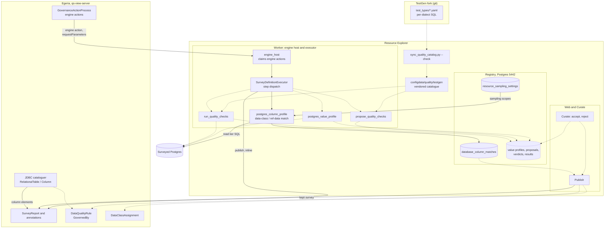

# How TestGen, Resource Explorer and Egeria fit together

**Status:** reference, 2026-10-20. Two views of the same integration (owner's option C: TestGen's test
catalogue is vendored as data; RE runs it; Egeria is the catalog of record):

- **Conceptual:** who does what, with no internals.
- **Technical:** the modules, tables and calls.

In the technical view, **solid** lines and boxes are built and merged. **Dashed** ones are designed and
not built: see `DESIGN-VALUE-PROFILE-AND-QUALITY-CHECKS.md` and `DESIGN-PUBLISHING-COLUMN-VERDICTS.md`.

## Conceptual

Three points the picture carries:

- **TestGen does not run.** Its test-type definitions and per-dialect SQL are copied into RE as data and
  kept in step by a sync script.
- **A person decides what becomes a fact.** Measurements and proposals reach Egeria as survey
  annotations. Accepted rules and confirmed data classes reach it as governance elements, only by a
  person's Publish.
- **Either side can coordinate a survey.** Egeria can start a survey through RE's engine host, or RE can
  run it itself. The results land in the same place either way.

## Technical

Reading the technical view:

- **Built and merged:**
  - the engine host forwarding the request parameters a step declares (#766);
  - column-profile verdicts published by the executor (#750, live-verified 2026-10-20);
  - the verdict store `database_column_matches` (#759);
  - sampling settings at every scope (#767);
  - Curate's Publish of the kept survey.
- **Designed, not built:**
  - the vendored TestGen catalogue and its sync script;
  - the value-profile, propose and run steps, and their tables;
  - Curate's Publish sending the stored verdicts (`DESIGN-PUBLISHING-COLUMN-VERDICTS.md` §1);
  - accepted checks becoming `DataQualityRule`s, and confirmed verdicts becoming `DataClassAssignment`s.
- **Who each call runs as:**
  - Publish runs as the signed-in person.
  - The engine host runs as `Daemon(ENGINE_HOST, requested_by)`.
  - A queued run publishes as the service account, with `Ownership` set to the requester.
- **What Egeria creates itself:** column elements, made by Egeria's JDBC cataloguer for schemas a Curate
  catalogue commit chose. RE finds them by walking the schema; it never creates them.
