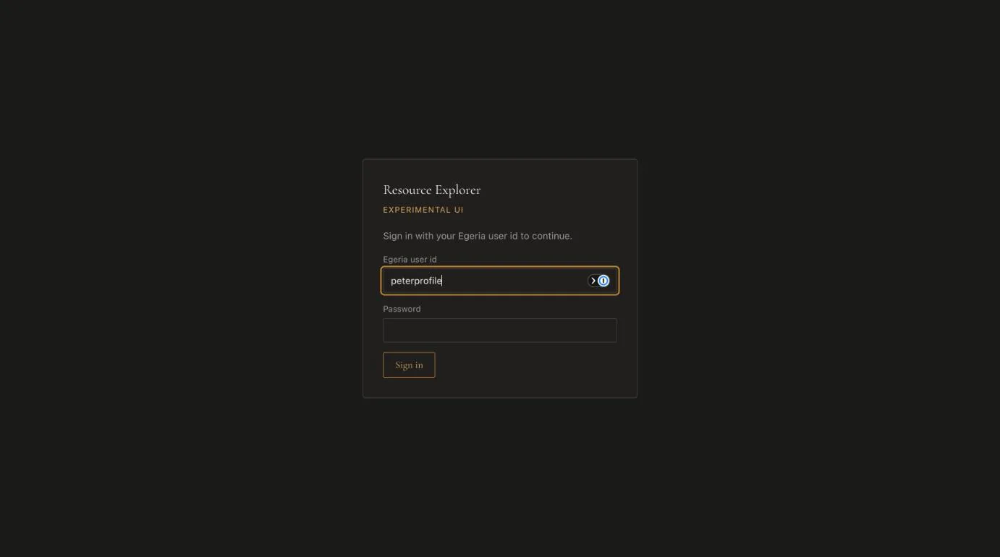
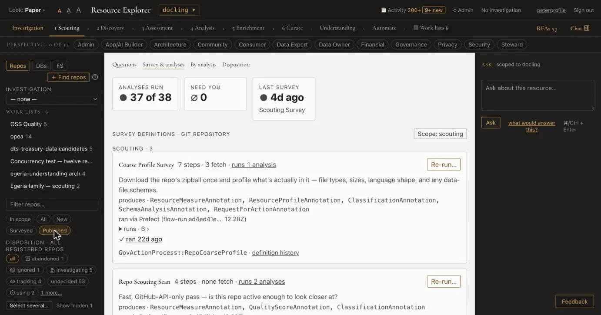

# Walk 1 — Sign in, pick an investigation, find a repository

*Screens read on 2026-10-29, Explorer on port 8813, `origin/main` at `afdac240`.*

## 1. Sign in

Open `http://localhost:8813/`. Resource Explorer asks you to sign in before it shows anything. Use your Egeria user id and password: Egeria is the identity provider and there is no separate Explorer account.

*"Sign in with your Egeria user id to continue." The panel offers one button, "Sign in".*

## 2. The screen

Once you are in, the header reads **Look: Paper**, three text-size controls, the title, the resource picker, **Activity**, **Admin**, the current investigation ("No investigation"), your user id and **Sign out**.

*The stage strip reads "Investigation · 1 Scouting · 2 Discovery · 3 Assessment · 4 Analysis · 5 Enrichment · 6 Curate · Understanding · Automate · Work lists 6". The right rail reads "ASK scoped to docling".*

The sidebar has three kinds of resource (**Repos**, **DBs**, **FS**), an **INVESTIGATION** picker (here "— none —"), **WORK LISTS · 6**, a filter box and, for repos, the chips **In scope**, **All**, **New**, **Surveyed** and **Published**. The row **PERSPECTIVE · 0 OF 12** narrows the list by who is asking.

## 3. Pick an investigation

The **Investigation** stage, at the left of the strip, is where you choose the frame for your work.

*"An investigation is the frame a body of work runs inside — why it exists, not what kind of work it is." The EGERIA column reads "☁ Egeria", "🏠 local" or "unbound by reset".*

Open a row to read the investigation; walk 6 opens one. Choosing one as current is a button on that page ("Make current"); this walk did not press it.

## 4. Find a repository

Use the filter box and the chips. **Published** keeps the repositories Egeria already holds.

*The chips under "Filter repos…" read "In scope · All · New · Surveyed · Published".*

To bring in repositories you do not have yet, use **+ Find repos** ("Find and import candidate repos" in the guide; hover text not re-verified on 2026-10-29). It fills a review table; nothing is registered until you tick rows and press **Import Selected** (see the guide, section 4). This walk did not open or press it.

**Not built yet in this walk:** nothing; see [the guide's list](../user-guide.md#10-not-built-yet).
