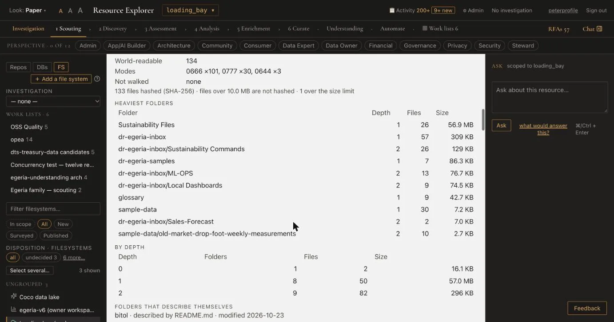

# Walk 4 — A file system

*Screens read on 2026-10-29, Explorer on port 8813, `origin/main` at `afdac240`. Resource: `loading_bay` ("Loading bay (exchange-quickstart)").*

Open it from the **FS** list in the sidebar. A file system is registered with a host and a container path (the guide, section 5; not re-verified on 2026-10-29; "+ Add a file system" is the sidebar's button; this walk did not press it).

## 1. The questions

*"0 of 5 answered · Scouting". The key reads "○ not run 2 · ⚠ needs you 2 · ○ no reader yet 1". The second question reads "Human-supplied: who owns this resource and who administers it are recorded in Enrichment; no survey reads either for a file system." with the button "Answer this →".*

## 2. Reach: who surveyed it, and what RE walked

![The Survey & analyses tab for loading_bay. Tiles read "ANALYSES RUN ● 2 of 7" and "NEED YOU ∅ 0". Under "SURVEY DEFINITIONS · FILE SYSTEM DIRECTORY" and "FOLDER SURVEY": "✓ Egeria can read /deployments/loading-bay · verified 2026-10-25 · led by Egeria's Folder Survey" with a "Check again" button, "path checked: /deployments/loading-bay", seven buttons (Survey, Measure beside Egeria's survey, Publish these measures to Egeria, Profile data files, Derive, Read narrative files, Match data classes), and the sentence "Egeria's Folder Survey leads here: its run time is Egeria's and is not priced by Resource Explorer; Resource Explorer's last walk beside it saw 134 files". Below it, Files 134, Folders 17, Total size 57.3 MB, File types 10.](images/04-filesystem/04-folder-survey.webp)

*"✓ Egeria can read /deployments/loading-bay · verified 2026-10-25 · led by Egeria's Folder Survey". "Egeria's Folder Survey leads here: its run time is Egeria's and is not priced by Resource Explorer; Resource Explorer's last walk beside it saw 134 files". Counts: "Files 134 · Folders 17 · Total size 57.3 MB · File types 10".*

The seven buttons start work, so this walk did not press any of them, nor **Check again**.

## 3. Walk measures

*"WALK MEASURES · measured by Resource Explorer · 2026-10-25 · beside Egeria's Folder Survey". "kept here · not published to Egeria". "133 files hashed (SHA-256) · files over 10.0 MB are not hashed · 1 over the size limit".*

The same tab goes on with "HEAVIEST FOLDERS" and "BY DEPTH" tables (folder, depth, files, size).

*"HEAVIEST FOLDERS" and "BY DEPTH". The first row reads "Sustainability Files · 1 · 26 · 56.9 MB".*

## 4. Narratives and data-file profiles

![The FOLDERS THAT DESCRIBE THEMSELVES and NARRATIVE FILES, READ IN FULL blocks. Each described folder reads, for example, "bitol · described by README.md · modified 2026-10-23" followed by the file's own first line and "a proposal · confirm it on Curate". "NARRATIVE FILES, READ IN FULL" reads "reads 4 narrative files in full (3.2 KB) … read · 2026-10-29 · 4 files read in full · 12 sections · 12 passages in Resource Explorer's search index", "each passage is stated by its file · a proposal, never a fact, until a person confirms it" and "kept in Resource Explorer's search index · not published to Egeria". "DATA-FILE PROFILES" follows.](images/04-filesystem/04-narratives-and-profiles.webp)

*"each passage is stated by its file · a proposal, never a fact, until a person confirms it". "kept in Resource Explorer's search index · not published to Egeria". "DATA-FILE PROFILES · 51 data files, 12.5 MB to read; Egeria will profile 36 CSV files, RE will profile 15 others; about 1 s".*

Each narrative is a proposal. The words "confirm it on Curate" name the next stop; on this build the Curate page for a file system says "Nothing to review for file systems yet" (see walk 5).

## Not built yet in this walk

- A table of the file system's proposals on Curate to review and confirm (the Curate page reads "Nothing to review for file systems yet", 2026-10-29).
- Remote reach for a file system (designed, not built; see [the guide's list](../user-guide.md#10-not-built-yet)).
